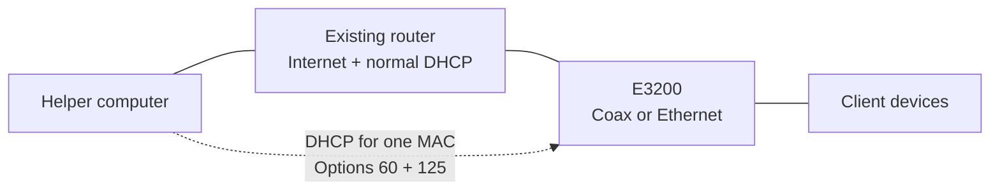

<p align="center"></p>

<p align="center">
<a href="https://github.com/travismansook/e3200-dhcp-helper/actions/workflows/ci.yml"></a>
<a href="LICENSE"></a>

</p>

# E3200 DHCP Helper

**Supply the DHCP vendor options an E3200 expects, while keeping your existing router in charge.**

A configuration-driven helper for Windows, macOS and Linux. It offers an IPv4 lease to **one configured extender MAC address**, including DHCP options **60** and **125**. Your router continues providing Internet access and normal DHCP for other devices.

[Windows setup](docs/windows.md) · [macOS setup](docs/macos.md) · [Linux setup](docs/linux.md) · [How it works](docs/how-it-works.md) · [Engineering case study](docs/portfolio.md)

## Why this exists

An E3200 client repeatedly rejected visible DHCP offers. Its logs revealed a missing vendor-class identifier; a first helper supplied it and exposed a second missing requirement, vendor-identifying information. Supplying both fields produced an accepted lease in the original Windows trial.

This project turns that investigation into inspectable configuration, scoped launchers and reproducible offline checks. It wraps existing DHCP engines rather than implementing a new network server.

## At a glance

| Platform | DHCP engine | Operation | Status |
|---|---|---|---|
| Windows | Separately downloaded Tftpd64 v4.74 | Native PowerShell launcher | Original prototype field result; generalized launcher needs validation |
| macOS | dnsmasq | Python foreground runner | Configuration syntax checked; public runner needs field validation |
| Linux | dnsmasq | Python runner and optional Ubuntu systemd service | Experimental runtime support |

The helper handles **DHCPv4 compatibility only**. It does not route traffic or implement a vendor management controller. Previous-generation extenders with the CHR30A remain outside Verizon's supported combinations. [Compatibility reference](https://www.verizon.com/support/residential/internet/equipment/routers/wi-fi-access-point)

## Architecture



The helper is available when the extender requests or renews a lease. Internet traffic continues through the router, not the helper computer.

## Prepare your address plan

1. Use a LAN you own or administer.
2. Choose available helper and extender addresses, and exclude them from the router's dynamic pool. Check existing leases, reservations and manual assignments.
3. Give the helper a stable wired IPv4 address.
4. Read the extender's actual MAC address from its label or management page.
5. Stop previous helpers; run only one.
6. Start with a **60-minute lease** so renewal can be verified.

The example uses `192.168.1.250` for the extender, `192.168.1.240` for the helper and `192.168.1.1` for gateway/DNS. **These are examples, not verified assignments.** Replace the sample MAC and interface too.

## Quick start

### Windows

Install no Python dependency. Follow the [Windows guide](docs/windows.md) to obtain the pinned portable Tftpd64 executable, copy `config.example.json` to `config.local.json` and enter your verified settings.

```powershell
.\windows\Start-Helper.cmd -Config .\config.local.json -ValidateOnly
# Then, in an Administrator terminal:
.\windows\Start-Helper.cmd -Config .\config.local.json
```

### macOS and Linux

Install Python 3.10+ and dnsmasq through your platform's package manager, then:

```sh
python3 e3200_helper.py init --output config.local.json
# Edit config.local.json with your verified plan and real interface.
python3 e3200_helper.py check --config config.local.json
python3 e3200_helper.py render --config config.local.json --format dnsmasq
sudo python3 e3200_helper.py run --config config.local.json
```

Set `address_plan_confirmed` to the JSON boolean `true` only after reviewing the addresses. Offline validation can inspect an unconfirmed plan; serving requires confirmation. Follow the platform guide before running with administrator/root privileges.

## Verify the result

Look for DHCPREQUEST, DHCPACK and a client-side bound lease. Verify the current MAC/address mapping, renewal and reacquisition after an extender restart. Confirm that unrelated devices still receive their settings from the original router.

A later full-day device-log sample contained **4,320 gateway-loss reports at 0%**. Those were sampled gateway checks, not a continuous or end-to-end benchmark. Prototype evidence does not establish every path in the generalized launchers. See the [validation record](docs/validation.md).

## Inspect and contribute

```sh
python3 -m unittest discover -s tests -v
python3 tools/analyze_bhm.py YOUR_LOCAL_LOG --date YYYY-MM-DD
```

Tests use synthetic inputs and do not start a DHCP server. The optional analyzer reports log coverage, explicit state transitions, sampled loss and clock reversals.

- [Troubleshooting](docs/troubleshooting.md)
- [Contributing](CONTRIBUTING.md)
- [Security and operational scope](SECURITY.md)
- [Third-party notices](THIRD-PARTY-NOTICES.md)
- [Portfolio case study and résumé wording](docs/portfolio.md)

Original project code is [MIT licensed](LICENSE). No external DHCP binaries or private network logs are bundled. This independent project is not affiliated with Verizon.
