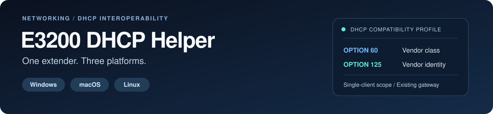

<p align="center"></p>

<p align="center">
<a href="https://github.com/travismansook/e3200-dhcp-helper/actions/workflows/ci.yml"></a>
<a href="LICENSE"></a>
</p>

# E3200 DHCP Helper

**A workaround for an E3200 that turns yellow and won't accept a network address after a router change. It can also restore access to the extender's settings page.**

This project came from keeping an existing **Verizon E3200 extender** after switching from a **CR1000A to a CHR30A**. The extender developed a yellow-light problem, and its settings page could not reliably be reached using the IPv4 address shown on the network.

The cause in that setup was the way the E3200 accepted its network address. This helper supplies the missing information so it can accept an address and communicate with the router.

**New here?** Read the explanation below, then choose the [Windows](docs/windows.md), [macOS](docs/macos.md), or [Linux](docs/linux.md) setup guide.

Looking for the original, more technical README? It is preserved in [README-TECHNICAL.md](README-TECHNICAL.md).

## What was causing the problem?

Devices normally ask the router for a local IP address. That address lets other devices on your home network find them. The process is called **DHCP**.

In the original setup, the router offered the E3200 an address, but the extender rejected the offer because it was missing extra manufacturer information the E3200 expected. The logs showed two missing pieces, called **options 60 and 125**.

That explains why an address displayed on a status page did not necessarily work: it was not proof that the extender had accepted a current, usable address.

Once the helper supplied both pieces of information, the E3200 accepted its address. **Access to its settings page worked again**, and the yellow-light condition cleared during the original trial.

## What does the helper do?

It runs on a computer on your home network and answers the E3200 when it asks for an address:

1. It recognizes your E3200 by its device ID, called a **MAC address**.
2. It offers the extender the unused IP address you chose, with the extra information it expects.
3. It tells the extender to keep using your existing router for Internet access.

Your CHR30A stays the main router. It continues assigning addresses to your other devices, and your normal Internet traffic continues through it.

The helper is configured for **one extender**. It does not replace your router, require the old CR1000A, or make your computer carry everyone's Internet traffic.

For the protocol details, see [How it works](docs/how-it-works.md).

## Is this for every E3200 yellow light?

**It targets this particular address-assignment problem.** A yellow light alone does not identify the cause.

Verizon describes a solid yellow light as a connection problem; blinking yellow can indicate placement or signal issues. Check your power and coax/Ethernet connection too. See the [official E3200 light guide](https://www.verizon.com/support/knowledge-base-305628/).

This is an independent workaround. Verizon does not list the E3200 as a supported extender for the CHR30A, and this helper does not establish full vendor-supported compatibility. See [Verizon's compatibility information](https://www.verizon.com/support/residential/internet/equipment/routers/wi-fi-access-point).

## What do I need?

- An E3200 with a working connection back to your home network, such as coax or Ethernet.
- A computer that can stay powered on, awake, and connected by Ethernet.
- Your extender's MAC address and a carefully chosen IP address for it.
- The setup files for your computer:

| Your computer | Start here | What to know |
|---|---|---|
| Windows | [Windows guide](docs/windows.md) | Uses a separately downloaded Tftpd64 program. No Python needed. |
| Mac | [macOS guide](docs/macos.md) | Uses Python and dnsmasq; the guide explains the dependencies. |
| Linux / Ubuntu | [Linux guide](docs/linux.md) | Includes an optional background service. Runtime support is experimental. |

Download the project using **Code → Download ZIP** on the repository page, extract it, and follow the guide for your computer. The guides explain which extra programs to download and how to start the helper.

The original Windows prototype obtained an accepted lease. Automated checks pass across platforms, but the public launchers still need testing in more real setups. The [validation record](docs/validation.md) separates what was observed from what was checked automatically.

## Before starting: keep the addresses from conflicting

The helper needs a stable address, and the extender needs an address another device will not receive.

The example configuration uses:

| Device | Example address |
|---|---|
| Main router | `192.168.1.1` |
| Helper computer | `192.168.1.240` |
| E3200 | `192.168.1.250` |

**These are examples, not settings to copy blindly.** Check your router's current device list, existing reservations, and any manually assigned addresses. Set the selected addresses aside from its automatic address pool as described in the setup guide.

Keep the main router's normal DHCP service enabled, and run only one helper. The platform guide walks through the remaining configuration and starting it.

## How do I open the E3200's network settings?

Once the E3200 has accepted the helper's address, open **the extender's assigned address** in a browser on your home network.

For example, if you configured the E3200 to use `192.168.1.250`, try:

```text
https://192.168.1.250
```

Use your actual extender address if you chose a different one. It is the `extender_ip` value in the helper configuration—not the helper computer's address.

Sign in with the extender's administrator credentials. The E3200's label contains its default administrator details.

**Restoring a usable address is what makes this page reachable again in the demonstrated setup.** If it does not open, confirm the extender actually accepted its lease and check its current address in the helper or router. A number left on an old status page may be out of date. See [Troubleshooting](docs/troubleshooting.md).

## What is a lease, and how long should it last?

A **lease** is how long the extender is allowed to keep an address before it expires. It normally tries to renew that lease before the time runs out.

The helper's `lease_minutes` setting controls the duration it offers:

| Setting | Duration | When to use it |
|---|---|---|
| `60` | 1 hour | Start here so you can check that renewal works. |
| `1440` | 24 hours | An option after successful testing, with the helper kept available. |
| `525600` | 365 days | An advanced choice that reduces scheduled renewals. It is not a permanent fix for an unavailable helper. |

Clients normally begin trying to renew around **halfway through the lease**, although the timers and device behavior can differ. A one-year lease therefore does not normally mean a full year without a renewal attempt. [DHCP lease behavior](https://www.rfc-editor.org/rfc/rfc2131.html)

Start with an hour, confirm the extender accepts the address and renews it, then choose a longer duration if appropriate. Changing the setting affects a new or renewed lease; it does not extend one that was already issued.

## Does the helper need to stay open?

**Plan to keep it running and the computer awake.**

If you close the helper or shut the computer down, the extender may keep working with the lease it already has. It will need the helper again when it requests or renews an address. A restart, lost lease, or other early request can bring that need forward.

The yellow light or inaccessible settings page **can return** if the extender cannot obtain the information it needs. A long lease does not remove that possibility.

For a longer-term setup, use a computer or small dedicated device that can remain available. The Linux guide includes an optional background service so a terminal window does not have to stay open.

## Getting help and technical details

If this looks like your issue, follow the guide for your platform and verify that the extender accepts its address, renews it, and can get an address again after a controlled restart.

- [Windows setup](docs/windows.md) · [macOS setup](docs/macos.md) · [Linux setup](docs/linux.md)
- [Troubleshooting](docs/troubleshooting.md)
- [Original technical README](README-TECHNICAL.md)
- [How the workaround works](docs/how-it-works.md)
- [Project case study and résumé wording](docs/portfolio.md)

When asking for help, share your router/extender models, helper platform, and a short description of what happened. Remove real MAC addresses, passwords, serial numbers, and other private network details from anything you post publicly.

Original project code is [MIT licensed](LICENSE). External programs are downloaded separately. This project is not affiliated with Verizon.
